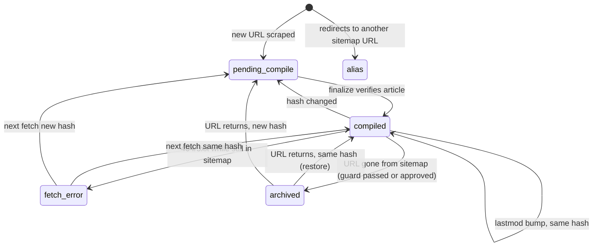

# feat: Sitemap-watching knowledge base plugin with incremental sync and qmd indexing

## Summary

Turn the knowledge base builder into an installable local Claude Code plugin that tracks one or more websites by sitemap. On demand or on a schedule, it detects new, updated, and removed pages, scrapes only what changed, compiles or recompiles only those wiki articles, rebuilds the wiki indexes, and refreshes a per-site qmd collection (BM25 + vectors) so the changes are immediately searchable.

---

## Problem Frame

Today the pipeline is a one-shot: `scrape.py` re-fetches every URL in a sitemap, keeps no state, and the compile skill tracks progress only by filename in `wiki/_compiled-log.md` — so an updated page is never recompiled, a removed page is never noticed, and nothing ends up in qmd unless someone hand-edits `~/.config/qmd/index.yml`. Keeping a website-derived knowledge base current means re-running the whole thing (10K pages ≈ 90 minutes and a full LLM compile) or living with drift. The goal is a "set it and forget it" loop: register a site once, and the wiki plus its search index stay in step with the site.

---

## Requirements

- R1. Ships as a Claude Code plugin installable from this repo (repo acts as its own marketplace); runs locally because qmd's index is local.
- R2. Users can register, list, and remove multiple sites; each site is fully namespaced (raw, wiki, archive, state, qmd collection).
- R3. A sync can be triggered on demand by the user, or on a recurring schedule without a human present.
- R4. Each sync classifies every sitemap URL as new, updated (lastmod or content hash changed), unchanged, removed, or reappeared (previously archived, back in the sitemap), and only compiles new/updated pages. URLs without lastmod are a fetch-needed flag, not a separate class.
- R5. Change detection uses sitemap `<lastmod>` when present and falls back to a content hash of the extracted markdown; a lastmod bump with identical content does not trigger a recompile.
- R6. An updated page overwrites its existing article (no duplicates), including when its topic classification changes.
- R7. Pages removed from the sitemap are archived out of the indexed tree, not deleted; a page that reappears is restored.
- R8. After compile, the wiki indexes are rebuilt and the site's qmd collection is re-indexed and re-embedded; qmd indexes the compiled wiki only, never raw.
- R9. Unattended runs skip the interactive cost confirmation but are bounded by a compile cap that is a total per run (across all sites in `sync all`); pages beyond the cap are deferred and surfaced to the user.
- R10. A failed or partial run never loses work, never double-processes completed pages, and never mass-archives a site because of a transient sitemap failure.
- R11. Local file ingest (`input/` → wiki) keeps working.

---

## Scope Boundaries

- No cloud execution (Cowork, `/schedule` cloud routines) — they cannot reach the local qmd index.
- No migration/adoption of wikis built by the old pipeline (e.g. the existing hand-curated `clay` collection); existing `raw/`, `wiki/`, and existing qmd collections' configuration are left untouched.
- No detection or protection of manual edits to compiled articles — a recompile overwrites. (Untracked files the user adds under a site's wiki are left alone.)
- No change to the wiki article body format beyond the header lines: `Created:` (preserved on recompile), a new `Updated:` line, and `Source:` set to the page URL.
- No JavaScript-rendered page support; extraction stays HTML-only (httpx + BeautifulSoup).
- No new topic-taxonomy inference engine; taxonomy is per-site config seeded from a generic default.

### Deferred to Follow-Up Work

- Adopt an existing wiki into sync state (match re-derived slugs to current sitemap, seed hashes) so large legacy wikis don't need a full recompile: separate plan.
- `/init` onboarding skill from the 2026-04-15 plan: folds naturally into `add-site` setup later; not required here.
- Push notifications to phone/Slack for cap-exceeded or failed runs beyond the run report: follow-up once the scheduled path is proven.
- Periodic automatic full hash sweep for sites with unreliable lastmod: ships as a manual `--full` flag now; automating it later.
- Isolating `kb-*` collections in a separate named qmd index so refreshes never touch unrelated collections (trade-off: default `qmd search`/MCP would not see them): revisit if the shared-index refresh proves disruptive.

---

## Context & Research

### Relevant Code and Patterns

- `scrape.py` — reusable: `ScraperConfig` (Pydantic), `create_client` (httpx HTTP/2), `extract_content` / `html_to_markdown`, `fetch_page` retry/backoff with 429 `Retry-After`. Weaknesses to fix: `discover_all_urls` returns `[]` on root failure (indistinguishable from empty), silently drops failed sub-sitemaps, doesn't catch `ET.ParseError`, no `.xml.gz`, fixed 2-level nesting, ignores `<lastmod>`; `fetch_page` discards the final redirected URL and collapses 404/5xx/empty into one "skip"; `url_to_filename` collapses `/a/b`, `/a-b`, `/a--b` to the same file.
- `ingest.py` — docx/pdf → markdown converters to keep as-is behind the new CLI.
- `.claude/skills/compile-wiki/SKILL.md` — Haiku sub-agent batching (~40 files/agent, 5 parallel), article template, index rebuild, compiled log. Agents currently choose their own output path; the manifest (a markdown table under `wiki/`) is the only evidence of success. Default taxonomy is site-specific and must become per-site config.
- `.claude/skills/scrape-and-compile/SKILL.md` — orchestration + cost-warning pattern; superseded by the sync skill.
- Uncommitted working-tree change flattens output to `raw/md/` (from `docs/plans/2026-04-15-001-feat-simplify-raw-path-init-command-daily-compile-plan.md`) — conflicts with per-site namespacing and is superseded by this plan.
- `.gitignore` excludes `uv.lock`, so dependency versions float on every venv rebuild.
- `~/.config/qmd/index.yml` (qmd 2.8.3) — global index config with per-collection `path`, `pattern`, `ignore` globs, `includeByDefault`, `update:` hooks, and per-path `context` descriptions. Holds hand-written entries for other collections; must only be touched through the `qmd` CLI, never rewritten. **`qmd update` takes no collection filter**: it reindexes every collection and runs each collection's `update:` hook (the `lpg` collection has `git pull --ff-only || true`). Only `qmd embed -c <name>` is scopeable. qmd uses its own embed lock, so a concurrent embed from another process fails.

### Institutional Learnings

- No `docs/solutions/` in this repo. README "Key lessons": sub-agents lose working directory — always pass absolute paths in agent prompts; indexes should be rebuilt from the filesystem (self-healing).
- Global rule `promptgtm-shared` confidentiality guard: this repo's remote is `promptgtm-shared/knowledge-base-builder`. The guard scans `git log --all`. GitHub's `main` (c1c35c1) is already a clean orphan commit with a sanitized compile skill; only the **local** `master` branch (136b0a0) and the stale `origin/master` tracking ref still carry the forbidden author email and term. Commits stay blocked until those local refs are gone — see U1.

### External References

- Plugin manifest & components: https://code.claude.com/docs/en/plugins/manifest-reference — only `name` required; components at plugin root; `${CLAUDE_PLUGIN_ROOT}` and `${CLAUDE_PLUGIN_DATA}` are substituted inline in skill markdown (not exported as shell env); `userConfig` with `type: directory` lets the user pick a folder at enable time.
- Self-hosted marketplace: https://code.claude.com/docs/en/plugins/marketplace-reference — `.claude-plugin/marketplace.json` with `"source": "."`.
- Plugin cache/data lifecycle: https://code.claude.com/docs/en/plugins/loading — plugin root is a versioned cache copy replaced on update; persistent data belongs in `${CLAUDE_PLUGIN_DATA}`; Python deps are not auto-installed.
- Desktop scheduled tasks: https://code.claude.com/docs/en/desktop-scheduled-tasks — local file access, app open + machine awake, one catch-up run, per-task permission mode (Manual mode stalls on unapproved tools); plugin/sub-agent support not explicitly documented.
- Headless: https://code.claude.com/docs/en/headless — `claude -p "/plugin:skill args"` loads installed plugins; unattended permission requests are denied, not hung; pre-approve via `--allowedTools` / `--permission-mode dontAsk`; avoid `--bare`.
- uv project env override: https://docs.astral.sh/uv/concepts/projects/config/ — `UV_PROJECT_ENVIRONMENT` absolute path keeps the venv out of the plugin cache.

---

## Key Technical Decisions

- **Local Claude Code plugin named `kb-builder`, repo is its own marketplace.** qmd is a local binary with a local SQLite index; cloud runners can't reach it. Skills are invoked as `/kb-builder:<skill>`.
- **Code/data split.** Plugin code lives in the (replaceable) plugin root. All user data lives in a *KB workspace* directory chosen via `userConfig` (`kb_root`), so it survives plugin updates and is visible/editable by the user. The Python venv lives under `${CLAUDE_PLUGIN_DATA}` via `UV_PROJECT_ENVIRONMENT`; skills invoke the CLI with `uv run --frozen --project "${CLAUDE_PLUGIN_ROOT}"`, always quoting substituted paths (Windows paths may contain backslashes).
- **Pinned dependencies.** `uv.lock` is committed and used with `--frozen`, because content hashes depend on html2text/BeautifulSoup output; an unpinned upgrade could change every page's hash and trigger a full recompile.
- **Deterministic Python, LLM only for compile.** A Typer CLI (`kb`) owns everything that isn't writing prose: sitemap discovery, diffing, fetching, hashing, slugging, archiving, finalizing compiled output, index rebuild, qmd calls, locking, reporting. Skills orchestrate `kb sync prepare` → Haiku compile agents → `kb sync finalize` → `kb qmd refresh`. Keeps stateful logic unit-testable and LLM cost limited to pages that actually changed.
- **Time-bounded, resumable CLI steps.** Claude Code's Bash tool kills commands after 10 minutes. `prepare` processes fetches in chunks that persist state, stops at an ~8-minute budget, and returns `incomplete`; the skill loops until `ready`. `qmd refresh` likewise bounds `qmd embed` with its `--timeout` and loops while embeds are pending.
- **Per-site JSON state, written atomically per chunk/stage.** Honors the repo rule that state lives in the filesystem. Page records are keyed by normalized URL (`local://<filename>` for ingested files). Compile is an idempotent overwrite, so chunk/stage-level commits are safe.
- **Run-token workspace lock (not PID).** One sync run per workspace at a time (`sync all` holds it across sites, which also serializes qmd). `prepare` writes a lock containing a run id and heartbeat and returns the run id; `finalize` and `qmd refresh` require `--run-id` and refresh the heartbeat; staleness is heartbeat age only (6h). `kb sync abort --run-id` releases the lock on user decline or skill error, and the sync skill calls it on every non-success exit. A run that finds a live lock exits with `skipped: locked`. PID liveness is never used (short-lived CLI processes; and on Windows the usual probe can kill the target).
- **Run-scoped staging; orchestrator owns article paths.** `prepare` clears old run folders and writes `staging/<run_id>/queue.json` (slug, normalized URL, absolute raw path, raw content hash, priority). Compile agents write only `staging/<run_id>/<slug>.md` plus a JSON manifest (slug, topic) per batch. `finalize --run-id` accepts only slugs in that run's queue, records the compiled hash from the queue entry (not the current raw file), moves the article to `wiki/<topic>/<slug>.md`, removes the previous path if the topic changed, and only then advances state. Prevents stale output from a crashed run being published against newer content.
- **lastmod first, hash confirms.** lastmod unchanged → skip fetch. lastmod changed or absent → conditional GET (stored ETag/Last-Modified), then compare a whitespace-normalized hash of extracted markdown; only a hash change queues a compile. `--full` ignores lastmod for a hash sweep.
- **Fail closed on sitemap problems.** Any root/sub-sitemap fetch or parse failure aborts the run before diffing — nothing is archived. Additionally, when the site has at least 10 known non-archived pages and the removed set exceeds 20% of them, archiving is held and reported. An interactive sync can release a hold with `--approve-archive`, which applies the held set only if it still matches the current diff; unattended runs never approve.
- **Cap is a total per run; oldest-first queue; churn is surfaced.** Unattended runs compile at most N pages in total (default 50, one workspace setting) across all sites in the run. The queue is ordered by time-in-queue (oldest pending first), ties broken new-before-updated, so no class starves; pages flagged `churning` (hash changed on 3+ consecutive syncs) go last and are listed in the run report and `status` so dynamic-fragment noise is visible rather than silently eating the cap. The remainder stays queued and the run is reported `partial`. Interactive runs show the count and cost estimate and ask.
- **First sync is interactive, backlog can drain on schedule.** `add-site` performs the first sync with the cost confirmation and lets the user either compile everything now or compile the first N and let scheduled runs drain the rest. A site is only scheduled after its first sync completes `prepare` (all pages discovered and fetched).
- **Archive lives outside the wiki tree** (`sites/<site>/archive/`), so qmd never sees it without depending on ignore globs. Reappearing pages are restored from archive without an LLM call when the content hash matches.
- **qmd via CLI only, refreshed once per run when dirty.** Ensure collection `kb-<site>` (pointing at the site's wiki folder) with `qmd collection add`, sync topic labels with `qmd context add`. `finalize` sets `qmd_dirty` whenever the site's wiki changed. `kb qmd refresh` runs `qmd update` **once per invocation and only if at least one site is dirty** (it is global and runs other collections' `update:` hooks — accepted and documented), then `qmd embed -c kb-<site>` per dirty site, and clears `qmd_dirty` only after `qmd status` shows no pending embeds for that collection. The next run retries dirty sites first.
- **Reconcile never deletes files it doesn't own.** Reconcile removes only wiki files whose `Source:` URL maps to a state record with a different recorded path. Untracked files (user notes, stray agent writes) are left in place and listed in the run report.
- **Scheduling: spike first, desktop scheduled task preferred, headless fallback.** Plugin and sub-agent support inside desktop scheduled tasks is undocumented, so a Phase A spike (U12) decides the scheduler before the sync skill is built. The sync skill takes an explicit `--unattended` argument rather than trying to detect headless mode (no documented signal exists).
- **Local ingest = a non-sitemap source.** `input/` files go to a reserved `local` site keyed `local://<filename>`; re-ingesting the same filename with a new hash recompiles over the existing article; files stay in `input/` and are tracked by hash; sync never diffs or archives `local`.

---

## Open Questions

### Resolved During Planning

- Sitemap failure vs empty sitemap: fail closed + archive guard with explicit interactive release.
- Page identity & filename collisions: key on normalized URL (lowercased scheme/host, no fragment, consistent trailing slash, sorted query); slug derived from path and suffixed with a short URL hash only on collision; slug recorded in state so it's stable across runs.
- Redirects: store final URL; if it equals another sitemap URL, mark as alias (no separate article); off-domain or login redirects are skipped and reported.
- 404/5xx for a URL still listed in the sitemap: keep the existing article, record the error, retry next run — never archive on fetch errors.
- Lock contention: run-token workspace lock; skip and report.
- Cap scope: total per run across all sites.
- Can `qmd update` be scoped? No (verified in qmd 2.8.3) — call it once per run, only when dirty.
- Ingested files: reserved `local` site with `local://` keys, excluded from diff/archive.
- Taxonomy: per-site config, seeded from a generic default at `add-site`; new topic labels propagate to qmd contexts.
- `Created:` vs updates: keep original `Created:`, add/refresh `Updated:` on recompile.

### Deferred to Implementation

- Exact markdown normalization before hashing (which volatile fragments, if any, to strip beyond whitespace) — tune against real sites showing churn; the `churning` flag makes candidates visible.
- Default cap, churn threshold, chunk time budget, and stale-lock timeout values may be tuned after the first real scheduled runs.
- Whether `claude -p` waits for background sub-agents before exiting (U12 spike; if not, the compile step spawns agents in the foreground in unattended mode).

---

## Output Structure

Plugin (this repo):

    .claude-plugin/
      plugin.json
      marketplace.json
    skills/
      add-site/SKILL.md
      sync/SKILL.md
      status/SKILL.md
      schedule/SKILL.md
      compile-wiki/SKILL.md        # moved + adapted
      ingest/SKILL.md              # replaces scrape-and-compile's ingest mode
    src/kb/
      __init__.py
      cli.py
      config.py
      urls.py
      http.py                      # shared client + retry/backoff
      sitemap.py
      fetch.py
      convert.py                   # html_to_markdown + docx/pdf from ingest.py
      state.py
      diff.py
      finalize.py
      indexes.py
      qmd.py
      locks.py
      report.py
    tests/
      ...
    pyproject.toml
    uv.lock
    README.md

KB workspace (user data, at `kb_root`):

    sites.json                     # sites + workspace settings (cap)
    sync.lock                      # run-token lock
    sites/<site>/
      raw/<slug>.md
      wiki/_master-index.md
      wiki/<topic>/_index.md
      wiki/<topic>/<slug>.md       # qmd collection kb-<site> points here
      archive/<topic>/<slug>.md
      staging/<run_id>/            # queue.json, agent output, manifests
      state.json
      runs/<timestamp>.md          # run reports
    input/                         # local ingest drop folder

---

## High-Level Technical Design

> *This illustrates the intended approach and is directional guidance for review, not implementation specification. The implementing agent should treat it as context, not code to reproduce.*

Sync run (one site shown; `sync all` repeats prepare/compile/finalize per site under one run id, then refreshes qmd once):

```mermaid
sequenceDiagram
    participant S as sync skill
    participant K as kb CLI (Python)
    participant H as Haiku compile agents
    participant Q as qmd

    S->>K: kb sync prepare <site> [--unattended] [--full] [--approve-archive]
    K->>K: acquire workspace lock (run id); clear old staging
    K->>K: discover sitemap (fail closed) -> diff vs state.json
    loop until ready (each call <= ~8 min)
        K->>K: fetch chunk (conditional GET), hash, write raw, persist state
        K-->>S: incomplete
        S->>K: kb sync prepare --run-id
    end
    K->>K: restore reappearing pages; stage or hold archives
    K-->>S: ready + staging/<run_id>/queue.json (capped) + cost estimate
    alt interactive
        S->>S: confirm with user (decline -> kb sync abort)
    end
    S->>H: batches from queue -> staging/<run_id>/<slug>.md + JSON manifest
    S->>K: kb sync finalize <site> --run-id
    K->>K: accept queued slugs only, move to wiki/<topic>/, drop stale paths, archive removed
    K->>K: reconcile owned files, rebuild indexes, set qmd_dirty, write run report
    S->>K: kb qmd refresh --run-id
    K->>Q: if any site dirty: collection add/context sync, update (once), embed -c kb-<site> (bounded, looped)
    K->>K: clear qmd_dirty when no pending embeds; release lock
```

Page lifecycle in `state.json`:



---

## Implementation Units

Units are grouped into phases; dependency order is U1 → U2 → U12 → U3 → U4 → U5 → U6 → U7 → U8 → U9 → U13 → U10 → U11.

### Phase A — Foundation and risk retirement

### U1. Confidentiality cleanup (prerequisite for any commit)

**Goal:** Make the local repo committable under the `promptgtm-shared` guard.

**Requirements:** — (enabler for all units)

**Dependencies:** None

**Files:**
- None modified on `main` (GitHub's `main` already has the sanitized compile skill)

**Approach:**
- Prune the stale `origin/master` tracking ref, switch to a local `main` tracking `origin/main` (keeping the untracked `docs/plans/`), then delete local `master` so the old commit is unreachable.
- Discard the uncommitted `raw/md/` edits to `scrape.py` / `ingest.py` — superseded by the per-site layout, and U2 removes those files anyway.
- No history rewrite, force-push, or repo recreation is needed.

**Execution note:** Deleting the local `master` branch and discarding uncommitted edits are destructive — confirm with the user at execution time.

**Test expectation:** none -- repository hygiene, verified by the guard.

**Verification:**
- `git log --all` shows only allowed author emails; a dry-run commit passes the confidentiality guard.

### U2. Plugin scaffold, packaging, and CLI skeleton

**Goal:** Repo installs as the `kb-builder` plugin; Python code becomes the `kb` package with a Typer CLI runnable from skills.

**Requirements:** R1

**Dependencies:** U1

**Files:**
- Create: `.claude-plugin/plugin.json`, `.claude-plugin/marketplace.json`, `src/kb/__init__.py`, `src/kb/cli.py`, `src/kb/convert.py`, `src/kb/http.py`
- Modify: `pyproject.toml` (package layout, `kb` console script, `typer` dep, dev deps `pytest`, `respx`), `.gitignore` (stop ignoring `uv.lock`)
- Create: `uv.lock`
- Move: `.claude/skills/compile-wiki/` → `skills/compile-wiki/`; delete `.claude/skills/scrape-and-compile/` (replaced in U9/U13)
- Delete: `scrape.py`, `ingest.py` (logic moves into `src/kb/`)
- Test: `tests/test_cli.py`, `tests/test_convert.py`, `tests/test_http.py`

**Approach:**
- `plugin.json` declares `userConfig.kb_root` (type directory). Skills call the CLI inline as `UV_PROJECT_ENVIRONMENT="${CLAUDE_PLUGIN_DATA}/venv" uv run --frozen --project "${CLAUDE_PLUGIN_ROOT}" kb --root "${user_config.kb_root}" ...`.
- Move `html_to_markdown`/`extract_content` and the docx/pdf converters into `convert.py` unchanged in behavior.
- Move `create_client`, header rotation, and the retry/backoff + 429 `Retry-After` logic into `http.py` as a shared helper that U4 and U6 both consume.
- Typer app with subcommand groups: `site`, `sync`, `qmd`, `ingest`, `status` (bodies filled by later units as listed per unit).

**Execution note:** Characterization-first — capture current `html_to_markdown` output on 2-3 fixture HTML pages before moving the code, so the move is provably behavior-preserving (hash stability depends on it).

**Patterns to follow:**
- Pydantic config models as in `ScraperConfig` / `IngestConfig`.

**Test scenarios:**
- Happy path: fixture HTML with `.entry-content` → markdown identical to pre-move snapshot.
- Edge case: page with no content selectors → falls back to body.
- Happy path: docx fixture with headings + table → expected markdown.
- Happy path (respx): retry helper retries a 503 then succeeds; honors 429 `Retry-After`; gives up after max retries with a typed failure.
- Happy path: `kb --help` lists all subcommand groups; `kb --root <tmp> status` on empty workspace exits 0 with "no sites".

**Verification:**
- `claude plugin validate .` passes; plugin installs from local marketplace and its skills appear as `/kb-builder:*`.

### U12. Scheduler spike

**Goal:** Decide the unattended execution route before the sync skill is built on top of it.

**Requirements:** R3, R9

**Dependencies:** U2

**Files:**
- Create (throwaway, not committed): a minimal plugin skill that runs a Bash `kb` command, spawns one Haiku sub-agent that writes a file into `kb_root`, and exits.

**Approach:**
- Run the throwaway skill from (a) a desktop scheduled task with a pre-approved permission mode and (b) `claude -p` under `--permission-mode dontAsk` with cwd = `kb_root`, `--add-dir <kb_root>`, and `--allowedTools` covering `Agent`, `Bash(uv run:*)`, `Read`, `Write`, `Edit`, `Glob`.
- Check: plugin skill resolves, sub-agent runs with `model: haiku`, sub-agent writes into `kb_root` succeed, nothing stalls on a permission prompt, and whether `claude -p` waits for background sub-agents before exiting.
- Record the outcome (chosen primary route, exact flags, any foreground-agent requirement) in the README draft and in U10's approach.

**Test expectation:** none -- feasibility spike; the outcome is a recorded decision.

**Verification:**
- One route demonstrably completes the throwaway skill unattended, with the sub-agent's file present in `kb_root`.

### U3. Workspace layout and site registry

**Goal:** Register, list, show, and remove sites with per-site namespaces and config.

**Requirements:** R2, R11

**Dependencies:** U2

**Files:**
- Create: `src/kb/config.py`, `src/kb/urls.py`
- Test: `tests/test_config.py`, `tests/test_urls.py`

**Approach:**
- `sites.json` holds workspace settings (unattended compile cap, default 50) and site entries: id (slug derived from domain, user-overridable), sitemap URL, taxonomy (seeded generic default), `scheduled` boolean, first-sync-complete flag, created/last-sync timestamps. Atomic write (temp + rename).
- `local` is a reserved site id for ingest; it has no sitemap and its page keys are `local://<filename>`.
- `urls.py`: URL normalization and slug derivation with collision handling (suffix short hash of normalized URL), Windows-safe filenames, length cap.
- `site remove` deregisters; `site remove --purge` also deletes the site folder and its qmd collection (U8).

**Test scenarios:**
- Happy path: add site from `https://example.com/sitemap.xml` → id `example-com`, folders created, entry persisted.
- Error path: adding a duplicate sitemap URL or reserved id `local` → rejected with clear message.
- Edge case: `/a/b`, `/a-b`, `/a--b` → three distinct slugs (second/third get hash suffix), stable across calls given the same existing-slug set.
- Edge case: normalization — `HTTPS://Example.com/Path/#frag` and `https://example.com/Path` → same key; query params sorted.
- Edge case: non-ASCII path and very long path → valid Windows filename under length cap.
- Happy path: `site remove` without `--purge` leaves the site folder on disk.

**Verification:**
- Registry round-trips; slugs are deterministic and collision-free across a 1K-URL fixture.

### Phase B — Change detection

### U4. Robust sitemap discovery with lastmod

**Goal:** Return the full URL set with optional lastmod, or a hard failure — never a silent partial list.

**Requirements:** R4, R5, R10

**Dependencies:** U2, U3

**Files:**
- Create: `src/kb/sitemap.py`
- Test: `tests/test_sitemap.py`

**Approach:**
- Recursive sitemap index traversal with depth limit and visited-set; support `.xml.gz`; read `<lastmod>` per URL (ISO 8601, date-only allowed); catch parse errors.
- Return a result type that distinguishes success (entries) from failure (which sitemap failed and why). Any sub-sitemap failure = overall failure.
- Uses the shared client and retry helper from `http.py`.

**Patterns to follow:**
- `discover_all_urls`, `fetch_xml` in the old `scrape.py`.

**Test scenarios:**
- Happy path: flat sitemap with lastmod on some URLs → entries with lastmod or none.
- Happy path: index → sub-index → urlset (3 levels) → all URLs, deduped.
- Edge case: gzipped sub-sitemap → parsed.
- Edge case: index cycle (A references B references A) → terminates, no duplicates.
- Error path: root returns 200 with HTML body → failure result, not empty list.
- Error path: one of three sub-sitemaps 500s after retries → overall failure naming that sub-sitemap.
- Edge case: genuinely empty urlset → success with zero entries (distinct from failure).

**Verification:**
- No code path returns an empty success when any fetch/parse failed.

### U5. Sync state store, run lock, and diff engine

**Goal:** Persist per-page state, guard runs with a run-token lock, and classify the current sitemap against state.

**Requirements:** R4, R5, R7, R9, R10

**Dependencies:** U3, U4

**Files:**
- Create: `src/kb/state.py`, `src/kb/locks.py`, `src/kb/diff.py`
- Test: `tests/test_state.py`, `tests/test_locks.py`, `tests/test_diff.py`

**Approach:**
- Page record: normalized URL, slug, status (`pending_compile`, `compiled`, `fetch_error`, `archived`, `alias`), sitemap lastmod, ETag/Last-Modified, content hash, compiled hash, article path (topic + slug), final URL, queued-at timestamp, consecutive-hash-change count, timestamps, last error. Site-level: `qmd_dirty`, held-archive set, last run summary.
- Atomic JSON writes; state file versioned for future migrations.
- Diff output classes match R4: `new`, `updated` candidates (lastmod changed, or no lastmod → needs fetch; confirmed by hash in U6), `unchanged`, `removed`, `reappeared`, plus a retry set (`pending_compile`, `fetch_error` from prior runs).
- Archive guard: if known non-archived pages ≥ 10 and `removed` > 20% of them, store the removed set as held. `--approve-archive` applies the held set only if it equals the current `removed` set.
- Queue ordering: oldest `queued-at` first, ties new-before-updated; pages with consecutive-hash-change count ≥ 3 flagged `churning` and ordered last. Cap applied from a remaining-budget argument so `sync all` shares one total.
- Run-token lock: acquire writes run id + heartbeat; operations with `--run-id` verify ownership and refresh heartbeat; release explicit; stale only by heartbeat age (6h); `abort` releases.

**Test scenarios:**
- Happy path: empty state + 5 URLs → 5 `new`.
- Happy path: same lastmod as stored → `unchanged`, not fetched.
- Edge case: URL without lastmod → flagged for fetch every run, classified only after hash comparison.
- Edge case: page in `pending_compile` from a previous crashed run → included in retry set without refetch.
- Error path: 30 of 100 known pages missing → archive held; 3 of 100 → archived normally; 3 of 8 known → archived normally (below the 10-page minimum).
- Happy path: held set + `--approve-archive` with an identical removed set → released; with a changed removed set → still held, reported.
- Edge case: previously `archived` URL back in sitemap → `reappeared`.
- Happy path: 120 queued pages across two sites, total budget 50 → 50 queued in oldest-first order across both sites; remainder untouched.
- Edge case: page whose hash changed on 3 consecutive runs → flagged `churning`, ordered after non-churning pages.
- Happy path: lock acquired by `prepare`, then `finalize --run-id` from a separate process → ownership accepted (lock held across invocations of the same run).
- Error path: second `prepare` while a live lock exists → `skipped: locked`; lock with heartbeat older than 6h → reclaimed; `abort --run-id` → released.
- Error path: crash simulated mid-write → previous state file intact (atomic rename).

**Verification:**
- Diff and queue ordering are pure functions of (state, sitemap entries, budget) and fully covered by fixture tests.

### U6. Incremental fetch, raw write, and `sync prepare`

**Goal:** Fetch only what the diff requires in resumable chunks, decide which pages truly changed, write raw markdown, and expose it all as `kb sync prepare`.

**Requirements:** R4, R5, R9, R10

**Dependencies:** U5

**Files:**
- Create: `src/kb/fetch.py`
- Modify: `src/kb/cli.py` (`sync prepare`, `sync abort`)
- Test: `tests/test_fetch.py`, `tests/test_cli_prepare.py`

**Approach:**
- Conditional GET with stored ETag/Last-Modified; 304 → unchanged.
- On 200: convert, normalize, hash; same hash → update lastmod/headers only and reset churn count; new hash → write `raw/<slug>.md` with a small header (source URL, fetched-at), mark `pending_compile`, increment churn count.
- Record final URL after redirects; alias detection when it equals another sitemap URL; off-domain → skip with reason.
- 404/5xx for a still-listed URL → `fetch_error`, keep existing article; distinct counters for 404, 5xx, empty, convert error.
- `--full` treats every URL as needing fetch.
- Chunked execution: persist state after each chunk; stop at the ~8-minute budget and return `incomplete` with the run id; a re-invocation with `--run-id` resumes where it stopped. When fetching is complete: restore reappearing pages, compute archive actions, clear old staging run folders, and write `staging/<run_id>/queue.json` with the capped queue; return `ready` with counts and a cost estimate.

**Patterns to follow:**
- `fetch_page` concurrency semaphore in old `scrape.py`; retry via `http.py`.

**Test scenarios (httpx mocked with respx):**
- Happy path: new URL → raw file written, `pending_compile`, hash stored.
- Happy path: lastmod changed but identical body → no raw rewrite, stays `compiled`.
- Happy path: 304 with stored ETag → unchanged, no body processed.
- Edge case: content changed, lastmod unchanged, `--full` → detected as changed.
- Edge case: `/old` 301 → `/new`, both in sitemap → `/old` becomes alias, single compile.
- Error path: 503 after retries on a compiled page → `fetch_error`, article untouched, retried next run.
- Edge case: whitespace-only difference in body → same hash.
- Integration: budget forced to expire after the first chunk → `incomplete`; second call with `--run-id` completes without refetching chunk one; final `queue.json` matches an uninterrupted run.
- Happy path: `prepare` then `abort --run-id` → lock released, no queue left behind.

**Verification:**
- A second consecutive sync against an unchanged mocked site performs zero raw writes and queues zero compiles; Phase B is fully exercisable via the CLI with no LLM cost.

### Phase C — Compile, finalize, index, end-to-end

### U7. Finalize: run-scoped staging, reclassification, archive/restore, indexes, `sync finalize`

**Goal:** Turn agent output into wiki state the orchestrator controls, then rebuild indexes.

**Requirements:** R6, R7, R8, R10

**Dependencies:** U6

**Files:**
- Create: `src/kb/finalize.py`, `src/kb/indexes.py`, `src/kb/report.py`
- Modify: `src/kb/cli.py` (`sync finalize`)
- Test: `tests/test_finalize.py`, `tests/test_indexes.py`

**Approach:**
- Read `staging/<run_id>/queue.json` and the batch JSON manifests; accept only slugs present in this run's queue; verify each staged article exists, is non-trivial, and has a valid topic from the site taxonomy (unknown topic → `general`).
- Inject/preserve `Created:` (from existing article if any), set `Updated:`, set `Source:` to the page URL.
- Move to `wiki/<topic>/<slug>.md`; if the recorded path differs, delete the old file; advance record to `compiled` with the compiled hash taken from the queue entry. Unverified pages stay `pending_compile`.
- Reconcile pass: remove only wiki files whose `Source:` URL maps to a state record with a different recorded path (heals crash between write and delete); list untracked files in the run report without deleting; remove empty topic folders.
- Archive removed pages (unless held) by moving to `archive/<topic>/<slug>.md`; restore reappearing pages with matching hash without recompiling.
- Rebuild `_master-index.md` and per-topic `_index.md` deterministically in Python (replacing the inline skill script). Set `qmd_dirty` if anything under the site's wiki changed.
- Write `runs/<timestamp>.md`: counts per class, compiled, deferred by cap, churning pages, held archives (with the approve command), untracked files, errors, qmd status.

**Test scenarios:**
- Happy path: 3 staged articles + manifest → moved into topic folders, state `compiled`, indexes list them, `qmd_dirty` set.
- Integration: page previously in `topic-a`, recompiled into `topic-b` → only `topic-b` copy exists; `topic-a/_index.md` no longer lists it; empty `topic-a` removed.
- Error path: manifest lists a page whose staged file is missing → stays `pending_compile`, reported, others still finalize.
- Error path (crash-then-change): staged output left from run A; page content changes; run B queues it but defers it by cap → run B's finalize ignores run A's output; page stays `pending_compile` with the new hash.
- Edge case: agent reports unknown topic → filed under `general`.
- Happy path: recompile preserves original `Created:` and sets `Updated:` to today.
- Happy path: removed page → moved to archive, absent from wiki and indexes.
- Edge case: archive held by guard → nothing moved, report shows the approve command.
- Edge case: reappeared page with same hash → restored from archive, no compile queued.
- Edge case: orphan duplicate article for a tracked URL left by a simulated crash → removed by reconcile.
- Edge case: user-created note under the wiki with no `Source:` → left in place, listed as untracked.
- Happy path: finalize with no changes → `qmd_dirty` not set.

**Verification:**
- After finalize, every `compiled` record's article path exists, and every wiki file with a tracked `Source:` sits at its recorded path.

### U8. qmd integration and `qmd refresh`

**Goal:** Keep each site's qmd collection in sync with its wiki while touching the shared index as little as possible.

**Requirements:** R8, R10

**Dependencies:** U7

**Files:**
- Create: `src/kb/qmd.py`
- Modify: `src/kb/cli.py` (`qmd refresh`)
- Test: `tests/test_qmd.py`

**Approach:**
- Wrap the `qmd` CLI via subprocess (no shell), with timeouts and captured stderr; detect missing binary with an actionable error.
- `ensure_collection`: if `kb-<site>` missing, `qmd collection add <site wiki path> --name kb-<site>`; add a root context from the site name/description and per-topic contexts from taxonomy labels when absent. Never edit `index.yml` directly.
- `refresh --run-id`: if no site is dirty, do nothing. Otherwise run `qmd update` once, then for each dirty site `qmd embed -c kb-<site> --timeout <budget>`, looping across invocations while embeds are pending; clear `qmd_dirty` only when `qmd status` shows no pending embeds for that collection. Release the run lock at the end.
- `site remove --purge` calls `qmd collection remove`.

**Test scenarios (subprocess mocked):**
- Happy path: one dirty site with collection absent → add + contexts + one update + embed called in order; `qmd_dirty` cleared.
- Happy path: two dirty sites → `qmd update` called exactly once, embed called per site.
- Edge case: no dirty sites → no qmd command executed.
- Error path: embed exits 0 but `qmd status` still shows pending chunks → `qmd_dirty` stays set, report marks qmd incomplete.
- Error path: embed fails (e.g. qmd's own embed lock held) → `qmd_dirty` stays set, wiki state untouched.
- Integration: next run with `qmd_dirty` set and no new changes → refresh retried.
- Error path: `qmd` not on PATH → clear error naming the missing binary; sync still completes wiki stages.
- Edge case: new topic introduced this run → context added for it.
- Guard: no code path calls `qmd update` when nothing is dirty.

**Verification:**
- Against a real qmd install in a temp workspace, `qmd search` finds a freshly compiled article's unique phrase after one sync (manual check).

### U9. Sync skill and compile-wiki adaptation (end-to-end on demand)

**Goal:** First working end-to-end on-demand sync for one or all sites.

**Requirements:** R3, R6, R9

**Dependencies:** U8, U12

**Files:**
- Create: `skills/sync/SKILL.md`
- Modify: `skills/compile-wiki/SKILL.md`
- Test: `tests/test_e2e_sync.py`

**Approach:**
- `compile-wiki` becomes an internal step: input is `staging/<run_id>/queue.json` (absolute raw paths, site taxonomy, staging dir); agents write only to `staging/<run_id>/` (article per slug + JSON manifest per batch); cost warning moves to the sync skill. Absolute, quoted paths in all agent prompts. Foreground vs background agent spawning follows the U12 outcome for unattended mode.
- `sync <site|all> [--unattended] [--full] [--approve-archive]`: loop `prepare` until `ready`; if interactive and queue > 0, show counts + cost estimate (and any held archive with its URLs) and confirm; on decline or any failure call `sync abort`; spawn compile batches; run `finalize` per site; loop `qmd refresh` until done; summarize from the run report. Unattended: no questions, `--approve-archive` ignored, final message is the run report summary.

**Test scenarios:**
- Integration: `prepare` + simulated staged output (fixture agent output) + `finalize` + mocked `qmd refresh` on a mocked site → state, wiki, indexes, report consistent.
- Error path: sitemap failure in `prepare` → report `aborted`, nothing archived, lock released, skill stops before compile.
- Happy path: second sync with no site changes → zero agents spawned, no qmd calls.

**Verification:**
- End-to-end on a small real site (≤ 30 pages): first sync → change one page (or simulate via fixture server) → sync recompiles exactly that page and qmd returns it.

### Phase D — Onboarding, scheduling, docs

### U13. Skills: add-site, status, ingest

**Goal:** Remaining user-facing entry points.

**Requirements:** R2, R9, R11

**Dependencies:** U9

**Files:**
- Create: `skills/add-site/SKILL.md`, `skills/status/SKILL.md`, `skills/ingest/SKILL.md`
- Modify: `src/kb/cli.py` (`status`, `ingest`)
- Test: `tests/test_cli_status.py`, `tests/test_ingest.py`

**Approach:**
- `add-site <sitemap-url>`: register, show taxonomy for optional edit, run the first sync interactively; offer "compile all now" or "compile the first N now and let the schedule drain the rest"; then offer to schedule (hands off to U10).
- `status`: per-site last sync, page counts by state, pending queue size, churning pages, held archives with the approve command, qmd dirty flag, latest `partial`/`aborted`/qmd-incomplete runs.
- `ingest`: converts `input/` into the `local` site (`local://<filename>` keys, hash-tracked, files left in place), compiles via the same staging/finalize path, refreshes `kb-local`.

**Test scenarios:**
- Happy path: `status` on a workspace with one partial run and a held archive → both shown with actionable commands.
- Happy path: ingest a new docx → `local://` record, article compiled; re-ingest unchanged → no compile; re-ingest modified → recompiled over the same article.
- Edge case: file removed from `input/` → `local` article is not archived.

**Verification:**
- A new user can go from install to a searchable site wiki using only `add-site` and `sync`.

### U10. Scheduling

**Goal:** Recurring unattended syncs on the user's machine.

**Requirements:** R3, R9

**Dependencies:** U12, U13

**Files:**
- Create: `skills/schedule/SKILL.md`
- Modify: `src/kb/config.py` (per-site `scheduled` flag handling)

**Approach:**
- Use the route chosen in U12. Preferred: the `schedule` skill guides creating a desktop scheduled task (daily default) running `/kb-builder:sync all --unattended` with a pre-approved permission mode.
- Fallback: generate a Windows Task Scheduler / cron entry running `claude -p "/kb-builder:sync all --unattended"` with cwd = `kb_root`, `--add-dir <kb_root>`, `--permission-mode dontAsk`, `--allowedTools` covering `Agent`, `Bash(uv run:*)`, `Read`, `Write`, `Edit`, `Glob`, and absolute paths to `claude` and `uv`. Never `--bare`.
- Only sites with a completed first-sync `prepare` can be marked `scheduled`; `sync all --unattended` processes only scheduled sites.
- Notification channel for now: run report file + final message in the task's run history; `status` surfaces problems.

**Test expectation:** none -- orchestration/config; verified manually by a real scheduled run.

**Verification:**
- One scheduled run fires unattended, compiles at least one page via sub-agents, and produces a run report; a forced cap overflow shows as `partial` in `status`.

### U11. Documentation

**Goal:** README and CLAUDE.md describe the plugin, install, workspace, sync semantics, and scheduling.

**Requirements:** R1–R11 (documentation)

**Dependencies:** U10

**Files:**
- Modify: `README.md`, `CLAUDE.md`

**Approach:**
- README: install via marketplace, choose `kb_root`, `add-site`, `sync`, `status`, `ingest`, scheduling (chosen route + fallback), change-detection and archive semantics (including `--approve-archive`), cap behavior and churn reporting, qmd collection naming and the fact that a refresh reindexes all qmd collections and runs their update hooks, troubleshooting (qmd missing, locked workspace, held archive). Generic example domains only. Migration note: old `scrape.py` / `/scrape-and-compile` are replaced.
- CLAUDE.md: new structure and commands; drop `raw/`/`wiki/` root layout.
- Mark the 2026-04-15 plan's raw-path section as superseded.

**Test expectation:** none -- documentation.

**Verification:**
- Confidentiality guard passes; README commands match actual CLI/skill names.

---

## System-Wide Impact

- **Interaction graph:** skills → `kb` CLI → filesystem (workspace) and `qmd` CLI → global qmd index shared with unrelated collections (`clay`, `lpg`, ...).
- **Error propagation:** sitemap failure aborts before any write; fetch errors are per-page and non-fatal; compile failures leave pages queued; qmd failures leave a dirty flag and never roll back wiki state; every non-success exit releases the run lock via `abort`. Every run ends with a report regardless of outcome.
- **State lifecycle risks:** partial writes mitigated by atomic rename; double processing mitigated by the run-token lock, run-scoped staging, and idempotent overwrite; orphan articles healed by reconcile; mass archive blocked by the guard; long steps made resumable by chunking.
- **API surface parity:** old `scrape.py`/`ingest.py` CLIs and `/scrape-and-compile` are removed — users of the old commands must switch (README migration note).
- **Integration coverage:** prepare (chunked) → staged compile → finalize → qmd needs an end-to-end test with a mocked site and mocked qmd; real qmd and the scheduler verified manually.
- **Unchanged invariants:** existing qmd collections' configuration and `index.yml` entries are never edited; however, each refresh that has dirty sites runs a global `qmd update`, which reindexes all collections and runs their configured `update:` hooks. Legacy `raw/` and `wiki/` folders are ignored, not migrated or deleted; article body format stays the same apart from the header lines.

---

## Risks & Dependencies

| Risk | Mitigation |
|------|------------|
| Neither scheduler route can run plugin skills with sub-agents unattended | U12 spike in Phase A, before the sync skill is built; direct-API compile remains the last-resort alternative |
| Bash tool 10-minute limit kills long fetch or embed steps | Chunked, resumable `prepare` and bounded, looped `qmd refresh` |
| Global `qmd update` reindexes unrelated collections and runs their `update:` hooks (e.g. a `git pull`) | Called once per run and only when a site changed; documented; separate named index deferred as an option |
| Sites stamp all URLs with build-time lastmod → every run fetches everything | Hash confirms before compile, conditional GET reduces bandwidth, chunking keeps runs within limits |
| Content hash churn from dynamic fragments → spurious recompiles eat the cap | `churning` flag, churning pages ordered last, surfaced in report/status; normalization tuned per real sites |
| Dependency upgrade changes converter output → every page's hash changes | Committed `uv.lock`, `uv run --frozen` |
| `qmd embed` exits 0 with pending chunks | Clear `qmd_dirty` only after `qmd status` shows no pending embeds |
| `uv` / `qmd` / `claude` not on PATH or Windows paths mangled in scheduled context | Absolute paths in the scheduler entry; quoted substituted paths; CLI preflight check with actionable errors |
| Haiku agents ignore staging instructions and write into wiki directly | Finalize only trusts the run's queue + manifests; stray files reported as untracked, never silently trusted |

---

## Alternative Approaches Considered

- **Keep in-repo skills instead of a plugin:** simpler, but ties the tool to this checkout and mixes user data with code; rejected per the stated plugin goal.
- **Compile via direct Anthropic API calls from Python (fully headless cron, no Claude Code):** removes scheduler uncertainty but needs an API key and duplicates the existing sub-agent compile skill; kept as the fallback if U12 finds both scheduling routes unworkable.
- **SQLite for sync state:** better per-page transactions, but the repo rule prefers filesystem state; chunk-level JSON plus idempotent compile is sufficient at 10K-page scale.
- **Separate named qmd index for `kb-*` collections:** isolates refreshes from unrelated collections, but default `qmd search` and the qmd MCP server would not see the sites; deferred.
- **Delete removed pages instead of archiving:** simpler but loses content on transient sitemap glitches; rejected per confirmed scope.

---

## Phased Delivery

- **Phase A (U1, U2, U12, U3):** committable repo, installable plugin, scheduler route decided, site registry.
- **Phase B (U4–U6):** correct, resumable change detection exercisable end-to-end via `kb sync prepare` with no LLM cost.
- **Phase C (U7–U9):** finalize, qmd refresh, and the sync skill — first point where an on-demand sync runs end-to-end.
- **Phase D (U13, U10, U11):** onboarding/status/ingest skills, scheduling, docs — user-facing release.

---

## Sources & References

- Related code: `scrape.py`, `ingest.py`, `.claude/skills/compile-wiki/SKILL.md`, `.claude/skills/scrape-and-compile/SKILL.md`
- Prior plan: `docs/plans/2026-04-15-001-feat-simplify-raw-path-init-command-daily-compile-plan.md`
- External docs: https://code.claude.com/docs/en/plugins/manifest-reference, https://code.claude.com/docs/en/plugins/marketplace-reference, https://code.claude.com/docs/en/plugins/loading, https://code.claude.com/docs/en/desktop-scheduled-tasks, https://code.claude.com/docs/en/headless, https://docs.astral.sh/uv/concepts/projects/config/
